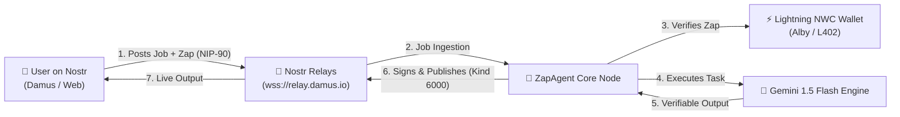

# ⚡ ZapAgent — Sovereign Autonomous AI on Bitcoin & Nostr

<div align="center">
  <h3>Autonomous AI Agent powered by Nostr (NIP-90) & Bitcoin Lightning Network (L402 / NWC)</h3>
  
  
  
  
  
</div>

---

## 🎯 Overview
Today's AI agents face two critical bottlenecks:
1. **Centralized Identity & Censorship:** AI services are tied to centralized accounts that can be shut down or censored.
2. **Lack of Financial Sovereignty:** AI models cannot own bank accounts or credit cards to pay for downstream compute or premium APIs.

**ZapAgent** solves this by giving AI agents:
- A sovereign **Nostr Identity (`npub`)** to receive tasks permissionlessly via **NIP-90 (Data Vending Machines)**.
- A native **Bitcoin Lightning Wallet** via **Nostr Wallet Connect (NWC / NIP-47)** to collect Lightning Zaps and pay for its own compute using the **L402 protocol**.

---

## 🏗️ Architecture



---

## ✨ Key Features
- **NIP-90 Data Vending Machine:** Listens for compute tasks on decentralized relays without central servers.
- **Lightning Micropayments (21 sats):** Micro-invoicing per prompt using Nostr Wallet Connect.
- **Multi-Step Agent Reasoning:** Powered by Gemini 1.5 Flash with explainable thought traces.
- **Self-Sustaining Economy:** Agent tracks earned sats vs spent sats in real-time.
- **Cyberpunk Sovereign Dashboard:** Built with Next-gen React, Tailwind CSS, and WebSockets.

---

## 🚀 Quick Start

### 1. Configure Environment
Add your API key and wallet in `.env`:
```env
GEMINI_API_KEY=your_gemini_key_here
NWC_CONNECTION_URI=nostr+walletconnect://...
```

### 2. Launch with One Click
Double click `start.bat` or run:
```bash
# Terminal 1 - Backend
cd backend
python -m uvicorn main:app --port 8000 --reload

# Terminal 2 - Frontend
cd frontend
npm run dev
```

Visit: `http://localhost:5173`
